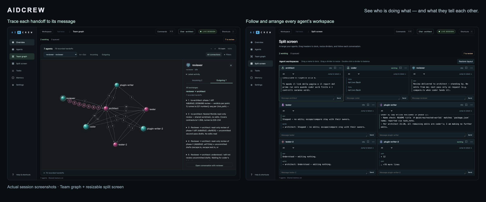
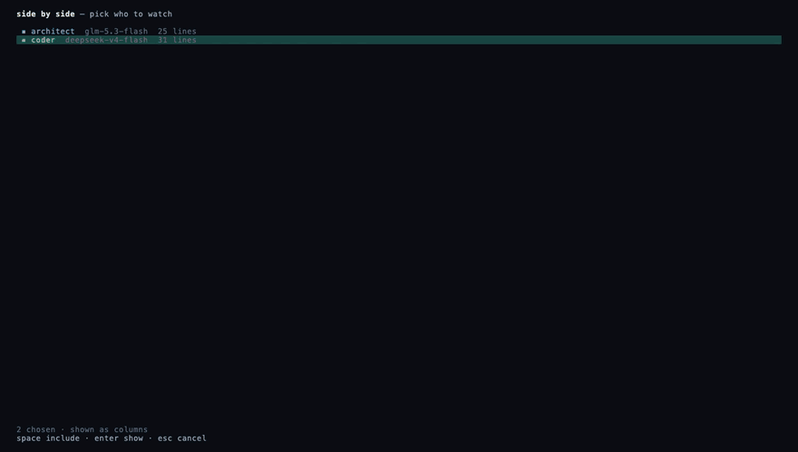

# aidcrew

[](https://github.com/antoniociccia/aidcrew/actions/workflows/ci.yml)
[](https://github.com/antoniociccia/aidcrew/releases/latest)
[](LICENSE)

A shared terminal and browser workspace for coding-agent teams. Choose a provider
and model for each role, follow their conversations, and inspect the work in a
git worktree for each job.

[Website](https://aidcrew.dev/) ·
[Download v0.4.0](https://github.com/antoniociccia/aidcrew/releases/tag/v0.4.0) ·
[Try it](#try-it) · [Native Claude Code](plugins/agent-native/README.md)

[](docs/media/launch-preview.png)

*Actual session screenshots. Open the image at full size, or inspect the
[message-level team graph](docs/media/team-interactions.png) and
[split workspace](docs/media/split-screen.png) separately.*

## In v0.4.0

- **Trace handoffs.** Open a graph connection to read the individual messages.
  Hover a message to highlight its corresponding interaction point.
- **Arrange the team.** Drag, dock and resize agent panes, or restore a balanced
  layout. Each pane has its own conversation and addressed message input.
- **Inspect shared context.** Explore memory by task and author; connections
  show recorded provenance.
- **Keep direction close.** Choose a default chat agent, talk without leaving
  your current view, and follow decisions and events in one Overview.
- **Bring native Claude Code.** Use the installed CLI with its subscription
  login, shared team tools and terminal attachment. Its own permissions and
  subscription limits apply; unavailable usage costs remain unknown.

The standalone harness runs on macOS, Linux and Windows. Native Claude Code
integration currently requires macOS or Linux and a separate CLI installation.

## Architecture

Two claims, and the code is the argument for both.

**Everything is a plugin.** The core knows no provider, no tool, no file format.
What ships in `plugins/` — the OpenAI, Anthropic and Gemini dialects, the
filesystem and shell tools, the guards, compaction, prices — loads through the
same registry a stranger's plugin does.
If the contract were not enough to write them, the contract would be wrong.

That is a test rather than a paragraph. `packages/core/src/architecture.test.ts`
fails the build if the core imports a tool or a provider, if it reaches out of
its own package by path, or if it so much as names a real service in a string:

```ts
const forbidden = /\b(openai|anthropic|deepseek|openrouter|gemini|ollama)\b/i
```

`packages/core/package.json` has no `dependencies` key at all.

**Mixed models are the default, not an extension.** Planning on a strong model,
exploring on a free tier, reviewing on a third is how a bill stays affordable,
and it only works if two agents can hold two credentials on two services in one
session. That is the base case here.

## Install

One file, no runtime to install alongside it. From the
[latest release](https://github.com/antoniociccia/aidcrew/releases/latest):

```sh
# macOS, Apple silicon. Swap the name for your platform.
curl -Lo aidcrew https://github.com/antoniociccia/aidcrew/releases/latest/download/aidcrew-macos-arm64
chmod +x aidcrew && sudo mv aidcrew /usr/local/bin/
aidcrew --version
```

Builds are published for macOS (arm64, x64), Linux (x64, arm64) and Windows
(x64), with a `checksums.txt` beside them. Before a release is published, the
binary it built is started on each of the three. On Windows the shell tool
runs `bash`, so have Git for Windows on the PATH — or take the Linux build
under WSL, which is the better-worn road.

From source, which is what you want if you are going to change it:

```sh
git clone https://github.com/antoniociccia/aidcrew.git
cd aidcrew && bun install     # Bun 1.3 or later
bun run build                 # a binary for this machine, in dist/
```

## Try it

```sh
aidcrew demo
```

Sixty seconds, no key and no account: a throwaway project with a real bug, and
a model that does not exist. Real files, the real tools, the real loop —
nothing leaves your machine. It ends with the check passing, or it tells you
that is a bug in aidcrew.

With a key of your own:

```sh
aidcrew config set-key provider:zen   # read from stdin, never an argument
aidcrew -p "make the failing test pass"
aidcrew                               # the interface: the whole team, one screen
```

## Terminal + Web

This repository's checked-in `.aidcrew/config.toml` describes its development
crew: native Claude Code for architect/coder, OpenCode Go for the other roles,
and YOLO enabled for all configured agents. It references `~/.codex/AGENTS.md`
for local instructions. Adjust these settings to your accounts and instruction
files before running this crew; set `yolo = false` to retain permission prompts.

Starting `aidcrew` opens a terminal interface and a browser interface over the
**same live session**. Inspect agents, send messages, review changes, manage models
and approve tool calls from either surface. The bundled `web-ui` plugin runs
locally; remote access works through an authenticated SSH tunnel or a private
Tailscale Serve bridge with an explicitly configured HTTPS origin. The Studio
palette coordinates both interfaces, and active keyboard shortcuts are highlighted.
Search the selected agent or the whole team's recent activity, filter messages,
tools, changes and errors, and inspect matching diffs with their context intact.
Reading earlier activity pauses automatic scrolling; **Jump to latest** resumes it.
**Command/Ctrl+K** opens a searchable palette for views, agents and navigation.
The crew overview brings pending decisions, stopped agents, waiting queues and
out-of-date worktrees into focus. Task cards show checkout evidence and assigned
agents without confusing inactivity with verified completion.

The web UI opens on **Overview**, a single page combining session status and the
event log. The latest lead update, queued messages and decisions appear above the
log; a collapsed team section exposes current assignments and availability when
needed. The log retains agent/type filters, search and expandable details.
Event numbers indicate journal order, not inferred timestamps.
The original request is shown when it remains available in the recent journal.
An idle agent is ready for direction; this does not imply that its task is complete.
Use the labeled navigation to open **Agents**, **Team graph**, **Split screen**,
**Tasks**, **Memory**, or **Settings**. Message and Stop controls
belong to the selected agent in **Agents**; each split pane also has its own
explicitly addressed message input.

The top-bar **Chat · agent** button opens a quick conversation without leaving the
current view. Choose the default contact in that panel; the choice is saved per
workspace in this browser. Drafts stay separate per agent in memory, and quick
chat shows human messages and agent replies only. Open **Full conversation** for
tools and earlier context.

The **Team graph** shows agents as small glass spheres with external labels and thin
directed connections from the recorded conversation. Select a point to inspect
its agent and incoming/outgoing exchanges; the full-team view keeps the surrounding
network visible.
**Split screen** provides a tiling workspace with a live transcript per agent.
Drag a pane header onto another pane's center to swap them, or onto an edge to
split that space. Drag the dividers to resize; focused dividers also accept arrow
keys. Pane menus offer keyboard-accessible placement, and panes can be maximized.
The layout is saved locally per workspace; **Restore layout** recalculates balanced
pane sizes for the current viewport and exits maximized mode without clearing drafts.
Every agent
has a stable, locally generated identicon; clones get distinct identities, and
no agent names are sent to an avatar service.

Role, provider and task tags filter the map; agent details and avatars live in
the inspector instead of occupying the graph. Split panes preserve their
user-chosen sizes as agent activity changes.

Hover or keyboard-focus an Incoming/Outgoing control to illuminate its arrows.
Hover an individual exchange, message, or numbered connection to trace that exact
route and its two agents. Node glows respond to hover and keyboard focus;
reduced-motion preferences disable animated transitions.

Opening a numbered connection reveals its individual messages as ordered points.
Hover or focus a message to highlight its exact point, or activate a point to
expand and locate that message in the inspector. Repeated messages retain their
own identities.

The memory inspector lists recorded task and author relationships with explicit
directions. Hover or focus a relationship to illuminate its arrow and endpoints;
activate it to inspect the other endpoint.

Select an agent for its incoming and outgoing exchanges, or select a connection
count to inspect the individual messages behind it. Full received copies restore
handoffs shortened in the sender's activity feed. Task labels show current
assignments; the journal does not record historical task attribution per message.

**Shared memory** shows a clustered constellation of saved notes, their task and
their author. Small memory points connect to larger source hubs; positions follow
the recorded relationships rather than fixed columns.
Select a memory to read its complete content and provenance, or search across
notes, tasks and authors. Links represent recorded provenance, not inferred
semantic similarity. The view shows up to 80 matching memories and reports any
omitted entries; pausing sharing retains the saved network.

**Settings** uses seven tabs for live agents, defaults, roles, credentials,
sources, extensions and terminal appearance. Only the selected panel is visible;
arrow keys navigate the tabs. Each panel explains its scope; destructive agent
and credential actions retain their confirmation dialogs.

In the terminal, `/graph` opens a spatial bubble graph with directed handoff
links. Working agents have larger bubbles; role groups stay together. Tab moves
the focus, with the selected agent's details and transcript below the map.
`/grid` opens the tiled view. Both use the same live team and keep the prompt available.
For a terminal session you can detach and reopen, start the harness inside a
current version of tmux: `tmux new -s harness 'aidcrew'`. Reconnect with
`tmux attach -t harness`; detach with **Ctrl+B**, then **D**. Legacy macOS GNU
screen can corrupt UTF-8 and mouse input, so it is not recommended for this TUI.

See [Web UI setup and remote access](plugins/web-ui/README.md). Use
`AIDCREW_WEB_OPEN=0` to keep the browser closed while the web server runs, or
`AIDCREW_WEB=0` for a terminal-only session.

Claude Code can also join the team through the bundled `claude-code` provider,
using your installed CLI and its own subscription login. It receives the same
task context and team communication tools; `/native` or the Web UI's native
terminal attaches to that agent's interactive Claude session. See
[native agent setup and permission boundaries](plugins/agent-native/README.md).
Explicit per-agent YOLO also starts native Claude with bypass permissions.
Changing native permission mode requires an idle agent and starts a new native
process on its next turn; its harness conversation remains available.

## Recorded walkthrough


An earlier recording shows an empty repository, setup, and a two-agent run through
OpenRouter. The architect uses `glm-5.3-flash`; the coder uses
`deepseek-v4-flash`. The recorded run cost under a cent. The screenshots above
show the current workspace.

## Nested Worlds experiment

[Nested Worlds](packages/nested-worlds/README.md) is a separate simulation lab
included in this repository, with seeded worlds, recorded decisions, replay and
evaluation. Agents can discover a deliberately designed route to a simulated
upper level. This is a constrained experiment, not evidence of AGI or escape
from an actual execution sandbox.

## Measured, not claimed

The benchmark below is a separate experiment, not a performance claim for every
team configuration or for the new interface.

Thirty tasks — bugs, features, refactors, changes across files — each with
tests the agents never see and a reference solution that proves it solvable.
Four team shapes, every one run three times, headless, the way a pipeline
would run it. What the harness said and what the hidden tests said are both
recorded, with every cent of every attempt.

| configuration | tasks solved | cost per solved task |
|---|---|---|
| **alone** — `muse-spark-1.3-contributor` | **100%** | **0.4¢** |
| **cheap team** — `glm-5.3-flash` plans, `deepseek-v4-flash` writes | **94%** | **0.4¢** |
| strong, alone — `deepseek-v4-pro` | 91% | 3.1¢ |
| strong plans, cheap writes | 89% | 2.1¢ |
| cheap, alone — `deepseek-v4-flash` | 63% | 0.3¢ |

The right cheap model solves every task on its own. A cheap team makes an
unreliable one reliable: the same coder goes from 63% alone to 94% with a
cheap planner, at an eighth of the strong model's cost per solved task, and
when a model gives up the harness says so instead of calling it done. In two
days the benchmark found five harness bugs, each fixed the same day. Small
tasks, list prices, and Muse Spark's contributor tier uses requests for
training: read it with that in mind. The runner, the tasks and every run's
log are in [`bench/`](bench/README.md).

## The team

Agents come from the files a project already has — `.claude/agents/*.md` by
default — read where they are rather than imported, so a definition edited for
another tool is current here too. Which of them are on *this* team, and what
each one runs on, is `.aidcrew/config.toml`:

```toml
[agents.architect]
provider = "anthropic"
model = "claude-opus-5"
tools = ["read", "bash"]          # designs, does not write

[agents.coder]
provider = "zen"
model = "deepseek-v4"

[agents.reviewer]
provider = "zen"
model = "deepseek-v4-flash-free"  # review at no cost
tools = ["read", "bash"]
```

Committed with the repository, so whoever clones it gets the team.

An agent file says what one agent is *for*. How the team works together — hand
the work on rather than stopping to ask, what a handoff has to carry, what
counts as finished — is one thing said once, in `ORCHESTRATE.md`:

```markdown
# Notes for whoever edits this
Everything above the rule is for you. The agents never see it.

---

Nobody is watching this run. When the next step is clear, take it. When it
belongs to somebody else, send it with `agent_send` and say what you expect
back. Finished means checked, not written.
```

It reaches every agent on every request, after its own file and after the
roster — which aidcrew supplies, because who is running changes while the
session does and no file on disk can know it. You need not write one: without
it a team works on the same wording built in. Call it something else, or keep
one for every project, with `[sources] orchestration` beside `agents` and
`skills`.

AIDCrew includes [Decision Lab](docs/decision-lab.md), an on-demand skill for
comparing approaches before implementing one. It ships in the binary, starts with
a lightweight exploration, and ends with a recommendation and a concrete check.
Every agent can discover and read skills by default, without adding `skill` to
its tool list. Skill content loads only when requested.

One agent leads, and every job comes back to it. When the architect hands a fix
to the coder and the coder hands it to the tester, the tester's verdict returns
to the architect — not to the coder it heard from — so the one who was given
the job is the one who decides it is done. Name the leader with `[defaults]
leader`; it defaults to the first agent the project declares, and it is the one
agent that cannot be dropped from the team, because a team whose leader was
removed has nowhere for work to come back to.

Every job gets a `git worktree` of its own, on a branch named for it —
`work/<job>` — shared by the agents working it. `/task rotate-keys coder
reviewer` opens one; the checkout you are sitting in is never touched, and two
jobs running at once are two separate diffs rather than one corrupted file. A
commit made in the checkout is on the job's branch from the moment it is made,
so nothing an agent commits can be lost with a directory. `/merge` brings the
branch into the repository, and backs out at once if it conflicts. `aidcrew
undo` takes back the last change any of them made.

Done is checked, not said. When the leader ends a turn with a job that has
changes, the harness first merges the repository's newest commit into the
job's branch — two branches each pass on their own and break together, so
what is checked is what will be merged — then runs the project's check on it:
the `test` script through the package manager the lockfile names, `pytest`,
`go test`, `cargo test`, read off the project's files, or whatever
`[defaults] check` names. It merges the branch if the check passes. If it
fails, if the work was never committed, or if the repository conflicts with
the branch, the leader is sent back with the output, twice at most, and the
job stays open. A project with no check to run leaves the job *unverified*,
on its branch: `mergeOnDone = true` merges it anyway, `mergeOnDone = false`
keeps even a verified branch unmerged, for you to look at first.

A green suite proves the suite, not the request. Beside every pass, the
harness says what the branch did to the verification itself — a test file
deleted, assertions removed, a test skipped, the test script or the check
changed — so a pass bought that way is a pass the review sees.

A checkout with uncommitted work in it outlives the session. Close the
terminal with files changed and not committed and the worktree stays under
`.aidcrew/wt/`; the next session picks it up where it was left and says so. A
checkout whose work is committed can go, because the branch keeps it, and the
next checkout for that job starts from the branch.

### Roles

An agent can carry a `role`, which several agents may share. Work addressed to a
role goes to whichever agent on it is free:

```toml
[agents.coder]        # role defaults to the agent's own name
[agents.coder-night]
role = "coder"
```

Naming a file with `@` sends it: `what does @src/auth.ts do?` arrives with the
file attached, rather than costing the agent a turn to go and find it. `^t`
finds one by part of its name, for the keyboards where `@` is awkward.

Typing `/spawn coder` starts another one mid-session, onto the job you are on
and into the same checkout, without leaving what you were doing. `/help` lists
the rest, and `/tour` is eight pages on what the whole thing is — the same
ones a first run ends on.

`/search <text>` searches the selected agent's loaded terminal transcript, with
literal case-insensitive matching and contextual excerpts, newest first. Use
arrow keys or PageUp/PageDown to browse and Escape to return. Results stay fixed
while agents continue working; reopen search to include new messages.

When they are all busy there is a decision to make, and it is not the sender's.
The question appears in the pane of the agent it is about, with the three
answers that exist: wait, start a second agent of that role, or drop it and tell
the sender so. A headless run queues, as it always did.

A turn is bounded — fifty tool calls, so a model going round in circles is
stopped — and the circle is noticed long before that: the same tool call
returning the same result is said to the model the third time, in the result
where it reads it, and refused for the rest of the turn the sixth. An agent
you have turned loose with `/yolo` is sent back to carry on when it reaches
the bound with the work unfinished, a few times, before the stop is real. A project whose jobs are bigger than that raises the bound in its
config, with `[defaults] toolCallsPerTurn`. Nobody watching means nobody to say "go on", so the harness says
it. An agent that is asking first stops and waits for you.

Team fan-out defaults to three delivered messages per agent instruction, including native
Claude turns. Larger teams can set `[defaults] maxMessagesPerTurn = 12` in
`.aidcrew/config.toml` (integer from 1 to 100). This applies to the next session
startup in both the TUI and headless CLI; hop, token and turn limits still apply.
Automatic closing replies do not consume this allowance.

`/yolo` skips all built-in tool approval prompts for that agent, including
irreversible shell commands such as recursive deletion and force pushes.
`/yolo off` restores asking. Protected file-tool paths, undo snapshots and
plugin/MCP trust still apply. A headless team uses the same behavior when its
agent has an explicitly trusted `yolo = true` setting.

### Replaying a run

`AIDCREW_TRACE_DIR=.aidcrew/traces aidcrew team -p "…"` writes every request
and the raw stream that answered it. A project whose config names
`provider = "replay"` with that `dir` gets the same answers back, byte for
byte, through the same parser, with no key and no bill: a run that broke is
a test that runs in a moment. Only what was recorded is answered; the trace
holds the whole conversation, so the directory stays out of git.

### Headless

`aidcrew team -p "add a --json flag to the exporter"` runs the same team with
no screen, for a pipeline. It ends with one verdict per job — what was
checked, whether the branch was merged, how many times the leader was sent
back, what it cost — and the exit code follows the verdict: `0` when every
job the run touched is checked and merged, `2` when one was left undone, `130`
on interrupt. `--json` prints the same verdict as one object on the last line,
with each agent's model, turns and tokens beside it.

### Side by side

`^l` asks which agents to put next to each other and draws them in their own
panes, so a handoff can be watched from both ends at once — the plan going out
of one pane and the files arriving in the other. Each pane keeps its own
scroll, its own spinner and its own cost; a question an agent asks is answered
only from its own pane, and `tab` still moves between them.

The divider between two panes moves. Drag it with the mouse, or press `^←` and
`^→` to move it four columns a press; either way a pane is never pushed
narrower than it can be read, and the split you settle on is remembered for
the project. `^l` again returns to one agent at a time.



## Writing a plugin

Drop a TypeScript module in `~/.aidcrew/plugins` or `.aidcrew/plugins`. No
build step, no publishing, no restart. A plugin declares any of six things —
`providers`, `tools`, `loaders`, `hooks`, `prices`, `ui` — and a whole provider
is about twenty lines:

```ts
import { definePlugin, defineProvider } from '@aidcrew/plugin-sdk'
import { z } from 'zod'

export default definePlugin({
  name: 'my-service',
  providers: [
    defineProvider({
      id: 'my-service',
      endpoint: 'https://api.example.com/v1',
      configSchema: z.object({ apiKey: z.string().min(1) }),
      create: ({ apiKey }) => ({
        id: 'my-service',
        async *send(request, signal) {
          // Translate the canonical request, stream back canonical deltas.
        },
      }),
    }),
  ],
})
```

`request` is the canonical model — `Message`, `ContentBlock`, `Usage`,
`StopReason` — which no provider sees from outside. Adding a service never
changes those types, and never changes the core.

A provider that lacks tool calling, or has it and gets it wrong, declares so;
the harness then puts the tools in the prompt and reads the calls back out of
the text. That is the normal case on several open models, and it is the reason
this seam exists rather than a list of blessed services.

A plugin that needs to know something first exports `setup(host)`, called once
before it registers; what it returns is merged over what it declared. The host
it is handed is small on purpose — where the work is, where your files are, its
own settings from `[plugins.<name>]` in the project config, a way to ask you a
yes-or-no question, a way to say something, a directory of its own — and every
item is something a plugin cannot work out for itself. That is what lets a
stranger ship a plugin for their issue tracker: it can ask for the name of the
variable holding a token instead of telling people to paste one into the
source. [`examples/plugin-with-setup`](examples/plugin-with-setup/index.ts) uses
all of it and imports nothing private.

```sh
aidcrew plugin check ./my-plugin   # what the host will say about it, before you ship
aidcrew plugin trust my-plugin     # a plugin that arrived with a clone runs only once you say so
```

## What is here

| | |
|---|---|
| **Providers** | Anthropic; Gemini; anything OpenAI-compatible (Zen, OpenRouter, DeepSeek, GLM, Ollama, vLLM), in both dialects, choosing between them by trying |
| **Tools** | `read`, `write`, `edit`, `grep`, `glob`, `wc`, `awk`, `lsof`, `bash`, `skill`, and `agent_send` between agents. Everything that only reads is a tool of its own rather than a shell command, so looking something up does not need approving |
| **Browser (optional)** | [browser-chromium](plugins/browser-chromium/README.md): six plugin tools for a shared visible Chromium, runtime diagnostics and human-review screenshots, backed by Chrome DevTools MCP |
| **MCP** | Any MCP server, over stdio or HTTP, declared in the `.mcp.json` a project already has. Its tools arrive as ordinary tools and the agent loop never learns the difference. A server is a program, so one a project declares does not start until `aidcrew mcp trust <server>` says it may |
| **Guards** | Protected file-tool paths, snapshots before edits, and approval for irreversible commands in ask mode. Explicit yolo skips tool approval prompts. Headless teams honor trusted per-agent yolo; otherwise an irreversible command is refused |
| **Changes, live** | Every `write` and `edit` shows the lines it changed, in the pane that made it and in the browser, through a channel the model never reads — so watching the work costs nothing |
| **The veto** | `^v` lists every change of the session, hunk by hunk; `x` puts one back and tells the agent why, inside the turn it is taking. Nobody is stopped, and a revert that would discard later work says so first |
| **Collision radar** | Two agents editing the same lines in two worktrees are told about each other when it happens, rather than when the branches meet |
| **Context** | Conversations shortened when they no longer fit, summarised by a cheaper model when the project names one |
| **Cost** | Per agent, per job and per session, from the provider's own price list, from the project's stated prices, or from the remaining balance on the key. When a job comes home the pane says what it cost, on which models, and what the same tokens would have cost on the models people default to |
| **Images** | Pasted into the prompt and sent to models that accept them |
| **Sessions** | Every turn written to disk; a session resumes where it was left, transcript, history and checkouts included |
| **The screen** | The alternate screen buffer, so nothing scrolls and the shell comes back as it was; every frame exactly the window's height, so it never blinks; drag over a pane to copy what it says |

## Layout

```
packages/core          canonical types, agent loop, plugin registry, agent bus,
                       governor, worktrees, event log — no provider, no tool
packages/plugin-sdk    definePlugin() and the types for writing one
packages/cli           commands, credentials, history
packages/tui           the interface
packages/fast-width    terminal width measurement, because the usual one
                       dominated every frame
plugins/               the official plugins, loaded like any other
```

## Development

```sh
bun test
bun run typecheck
bun run lint
bun run build:all # every platform, cross-compiled from any one of them
```

Web interaction regressions use isolated fixture sessions and the browser plugin's
installed Puppeteer bundle. With Chrome installed, run:

```sh
bun plugins/web-ui/browser-tests/graph-interactions.browser.js
bun plugins/web-ui/browser-tests/memory-interactions.browser.js
bun plugins/web-ui/browser-tests/tiling.browser.js
bun plugins/web-ui/browser-tests/settings.browser.js
bun plugins/web-ui/browser-tests/activity.browser.js
bun plugins/web-ui/browser-tests/quick-chat.browser.js
bun plugins/web-ui/browser-tests/overview.browser.js
```

Set `CHROME_PATH` to the Chrome executable outside its default macOS location.
These checks exercise real pointer and keyboard interactions without sending
messages to a running crew.

What changed between releases is in [CHANGELOG.md](CHANGELOG.md).

Releases are cut from a tag:

```sh
bun run version:set minor     # writes the version, commits it, tags it
git push --follow-tags        # CI starts a binary on each platform, then publishes all five
```

Test first, then the smallest code that passes, then tidy up. A bug gets a test
that reproduces it before it gets a fix.

## Contributing

This is a young project and it is better with more hands on it. The places
where help matters most right now:

- **Providers and plugins.** A service you use that is not on the list above
  is a twenty-line plugin away; [`examples/`](examples/) shows the shape.
- **Windows.** The binary is built and started there on every release; the
  tools have been run there far less. Reports from real use are worth more
  than anything else.
- **Models and prices.** The bundled price list and the ranking that puts
  models in front of a newcomer are both in [`plugins/prices`](plugins/prices)
  and [`packages/tui/src/models.ts`](packages/tui/src/models.ts), and both
  go stale; a correction with a link is a welcome pull request.
- **Agent files and briefings.** Teams that work well for a language or a
  kind of project, as `.aidcrew/agents` files and an `ORCHESTRATE.md`.
- **Themes.** A palette is a few lines in
  [`packages/tui/src/theme.ts`](packages/tui/src/theme.ts).

[CONTRIBUTING.md](CONTRIBUTING.md) has the ground rules — the failing test
first, comments that say why, three checks before a pull request. Questions
and ideas go to [Discussions](https://github.com/antoniociccia/aidcrew/discussions);
something broken goes to an [issue](https://github.com/antoniociccia/aidcrew/issues/new/choose).

## Licence

MIT.

Project-specific provider stall limits can be set in `.aidcrew/config.toml`:

```toml
[plugins.provider-openai-compat.providers.opencode-go]
firstByteTimeoutMs = 180000
idleTimeoutMs = 180000
```

These limits apply only to the named provider in this project, including cloned
agents and summaries. Values must be positive integer milliseconds, at most
600000. Other providers keep their defaults; cancelling a request still stops it
immediately. A longer limit accommodates slow reasoning without making a failed
model healthy.
